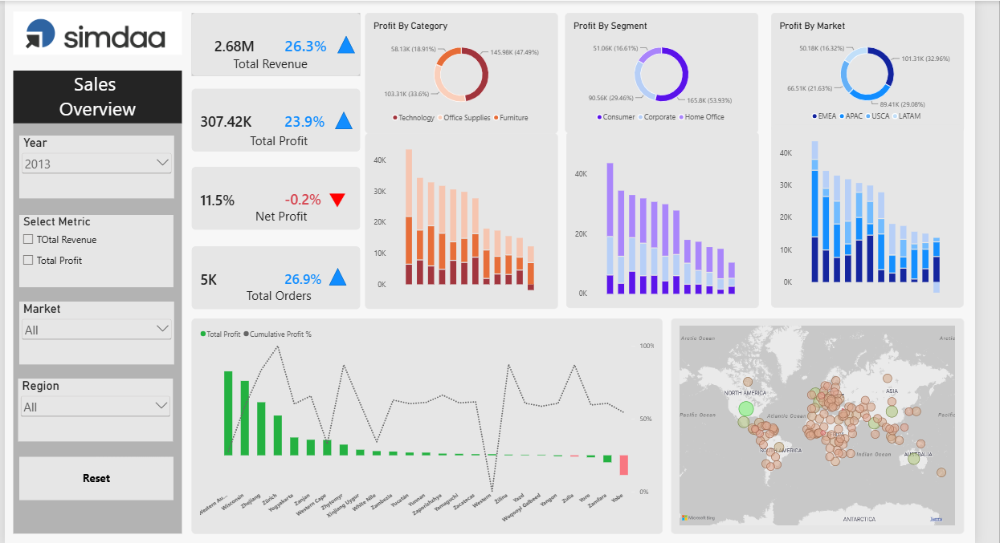

# Global Superstore Dashboard

## Project Overview
This project analyzes Global Superstore sales data to identify trends and generate meaningful business insights using Power BI.

## Tools Used
- Power BI
- Microsoft Excel

## Key Features
- Sales and profit analysis
- Regional performance analysis
- Product category analysis
- Interactive charts and slicers
- KPI cards and data visualization

## Project Files
- Excel dataset
- Power BI dashboard (.pbix)

## Dashboard Preview

